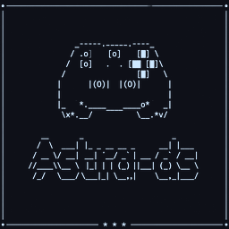
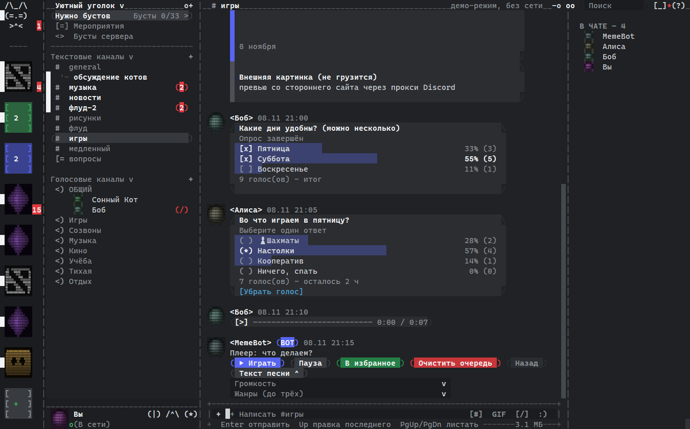
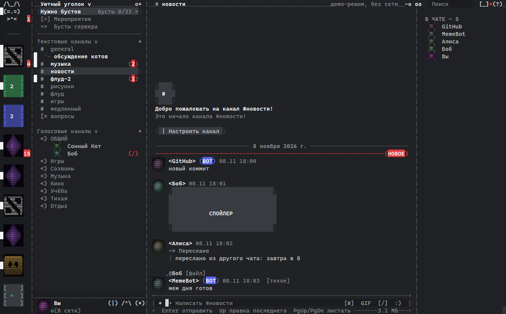
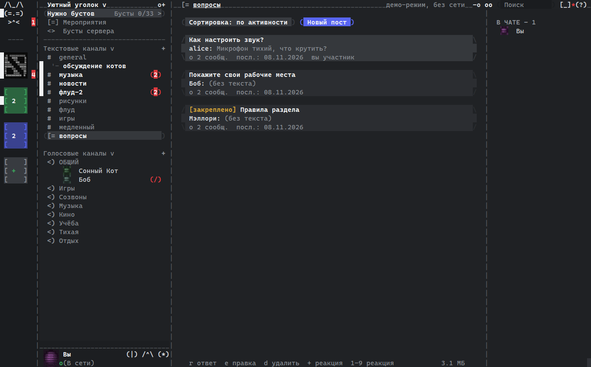
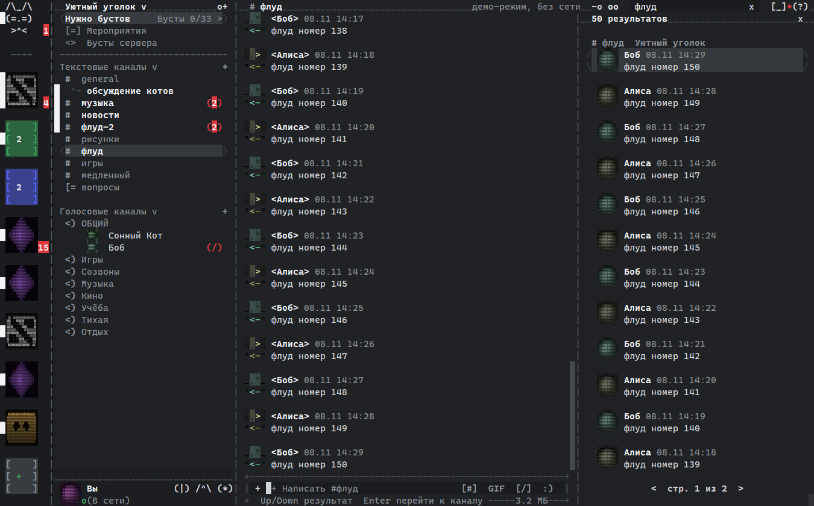
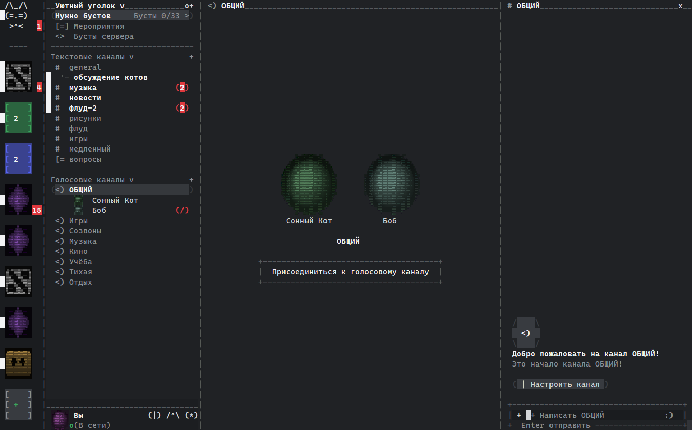
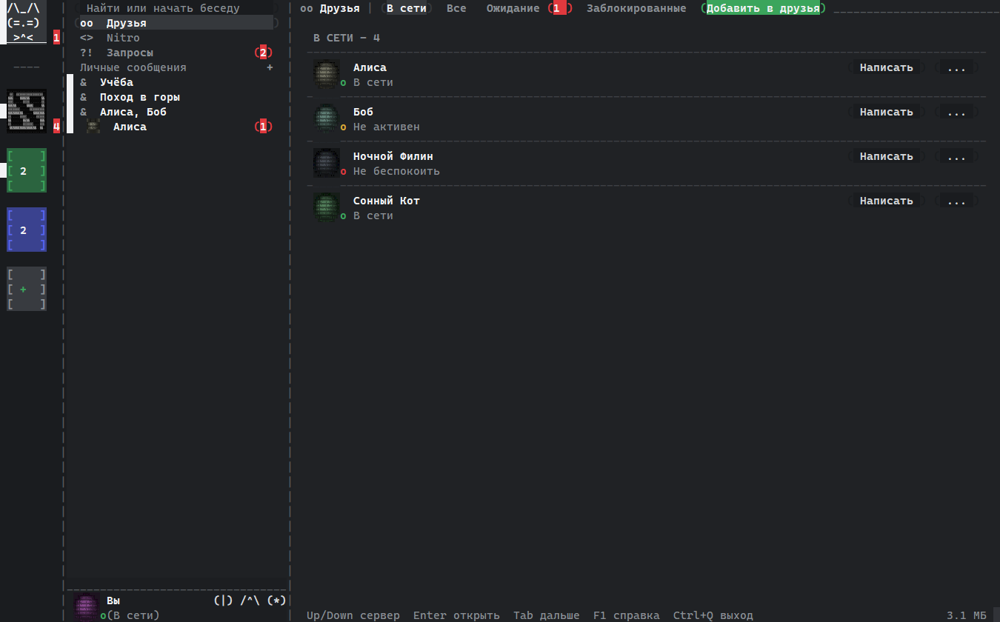
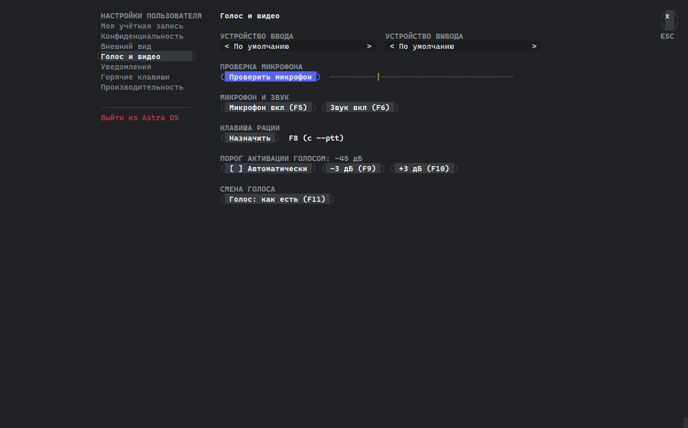
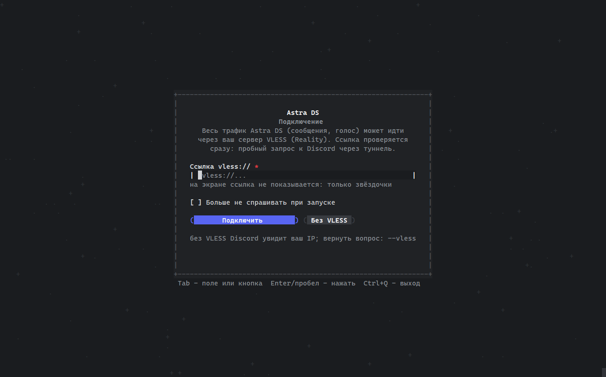

<div align="center">



# Astra DS

**A Discord client written in C that runs in about 3 MB of RAM.**

C11 · Windows and Linux · no Electron, no browser, no GPU




*A Discord-style window drawn with colored text characters: polls, a voice message, bot buttons and a link card. Everything here is fake demo data.*

</div>

> [!WARNING]
> **Third-party clients break Discord's Terms of Service**, and your account can be banned for using one.
> Use it at your own risk, ideally with a secondary account. This project has no affiliation with Discord Inc.
> To just look around, run `astra-ds --demo`: fake data and no network.

> [!NOTE]
> The interface is available in **English**: use the RU | EN switch on the start screen or run with `--lang=en`. The code and build are the same as the [Russian repository](https://github.com/Flaim92/astra-ds).

### If Discord locks your account

Discord disables an account or forces a password reset when it thinks the account is a bot or was compromised. It can happen with any client, but third-party clients trigger it more often. The usual causes are:

- joining or leaving servers;
- reconnecting often, which includes restarting the app many times in a row;
- opening DMs with people you don't know;
- changing your friends list.

**Log in with email and password.** If two-factor authentication is on, enter the code from your authenticator app after the password. QR code login is unreliable right now: Discord may ask for a captcha and then refuse to accept it. It behaves the same way in a browser, so this is not an Astra DS bug.

Do these in the official client. Astra DS sends you to the browser to join a server from an invite anyway, because Discord requires the official client for that. If your account gets locked, reset your password on discord.com, and if that doesn't help, [contact support](https://support.discord.com/hc/en-us/requests/new?ticket_form_id=360000029731).

### If your antivirus complains

The Windows build isn't signed, so SmartScreen warns about it. An antivirus may flag any Discord client as a token stealer, since the code contains the same words a stealer does, such as "token" and "Authorization". The token only goes to Discord and stays in the system keyring (Credential Manager on Windows, Secret Service on Linux). The code is open, so you can read it or build it yourself. Only download Astra DS from this repository.

## Why

The official Discord app is a whole browser inside a program. For comparison:

| | Idle RAM | Idle CPU | Binary |
|---|---|---|---|
| Discord (Electron) | usually 300-600 MB¹ | noticeably above zero | hundreds of MB |
| [larperCord](https://github.com/RshaCuDeVidro/larperCord) (Zig, SDL3) | ~130 MB² | 0-0.4%² | ~14 MB |
| **Astra DS** | **~2.9 MB**³ | **0%** | **~13 MB** |

<sub>¹ Estimate from Task Manager, depends on how many servers you're in. Not measured side by side.
² From the larperCord README, not our measurement.
³ Private bytes on Windows 11: median of five runs, 140x40 cell window, 2 s wait. A channel with images is 2.9-3.1 MB, a voice call with end-to-end encryption is 4-5 MB.</sub>

How it stays this small:

- **one thread and no polling loop.** The app sleeps until an event arrives, so idle CPU is 0%;
- **nothing extra in memory.** Discord events the client doesn't need are dropped without parsing. Login data is processed one server at a time;
- **images are drawn on the fly** from small previews and never stored;
- **voice only exists during a call.** Threads, codecs and encryption are created when you join and fully freed when you leave;
- **heavy things load on demand.** Server emoji, slash commands, forums and profiles are fetched when opened and freed when closed.

## Features

Against an inventory of 162 Discord screens and features, **86%** is done (84% not counting partial items).

- **Messages.** Send, reply (with or without pinging the author), edit, delete, react, silent messages, forwarding, per-channel drafts. A message being sent shows in gray, and a failed one can be retried.
- **Discord markdown.** Bold, italic, strikethrough, code, code blocks with a "Copy" button, headings, lists, quotes, spoilers. A `[text](url)` link shows the real address when it doesn't match the text.
- **Attachments.** Images and avatars as colored ASCII, full-screen viewer, text file previews, voice messages (streamed playback), sending files up to 10 MB with spoiler and description, drag and drop into the window.
- **Bots.** BOT tag, buttons and select menus, slash commands with options, link cards, polls with voting.
- **Servers.** Channels by category with permissions, server folders, threads and forums (create, join, archive, new post), pinned messages, slowmode with a countdown.
- **Management.** Create, edit, leave or delete a server. Channels and categories: create, rename, reorder, set permissions. Moderation when you have the rights: timeout, kick, ban, roles, moving people in voice.
- **People.** Friends with statuses, requests, blocking, ignoring, personal notes, full profiles, group DMs. Message requests and spam are kept apart from DMs, and their images don't load until you reply.
- **Voice.** Voice channels, calls in DMs and groups. DAVE end-to-end encryption is required: without it your voice is not sent. Per-user volume, microphone and output selection, mic test, automatic sensitivity, push to talk on any key or side mouse button, voice changer.
- **Navigation.** Channel tabs, quick switcher (Ctrl+K), search with `from:` `in:` `has:` `before:` `after:` filters, an inbox with mentions, Discord message links open inside the app.
- **Comfort.** Zoom with Ctrl+= and Ctrl+-, full screen with Alt+Enter, resizable columns, notifications and a tray icon, focus mode, keyword alerts, word filter.
- **Three modes.** A window with mouse support, a full-screen terminal mode (`--tui`) and a line-based IRC-like mode (`--cli`).

**Video** is in a separate build, **Astra DS Video**. The regular build has none of this code, so it stays just as light.

- **Screen sharing.** The whole screen or one window, 1280x720 at 30 frames per second. With sound: a single window is shared with its program's sound, the whole screen with all system sound except Astra DS itself (call voices do not go into the stream). On Linux it works on both X11 and Wayland (GNOME, KDE, sway and others, through the system source picker). On Wayland a single window is shared without sound for now: the system does not say which program it belongs to.
- **Watching other people's streams** in voice channels and calls.
- **Camera**: your own and other people's, as tiles or large (Alt+arrows, Alt+F). Turn it on with the `[]/` button, F12 or Alt+C.
- **Eye hiding on your camera.** The program finds your face in every frame and covers the eyes with a block of noise and random characters. If no face is found or the program is not sure, others see the Astra DS logo instead of the frame, and your preview says "Face not found". On by default, turn it off with Alt+E or the checkbox in the Camera dialog. Everything runs on your computer; frames go nowhere except the call.

**Not included:** animated GIFs, plugins.

## Privacy and security

- **No logs, no cache, no telemetry.** The only thing written to disk is the token, and it goes into the system keyring.
- **The token lives in locked memory** that is never swapped out and never ends up in crash dumps.
- **Your own VLESS (Reality) server** for all traffic, voice included. If the tunnel is down, the app asks instead of silently going direct.
- **Streamer mode** hides your email, the VLESS server address, invite links, file paths and DM text.
- **Panic key:** pressing it three times wipes the token, closes the app and clears the screen.
- **Captcha** opens right inside the app, and the action is retried automatically.
- **Quiet notifications.** By default they only say "new message", because Windows keeps notification history on disk.
- **Everything from the network is checked.** Control characters and text direction overrides are stripped, and the parsers are fuzz-tested (`tools/sec/`).

## Screenshots

<table>
<tr>
<td></td>
<td></td>
</tr>
<tr>
<td align="center">Bots, a spoiler and a forwarded message</td>
<td align="center">Forum</td>
</tr>
<tr>
<td></td>
<td></td>
</tr>
<tr>
<td align="center">Search with pages</td>
<td align="center">Voice channel</td>
</tr>
<tr>
<td></td>
<td></td>
</tr>
<tr>
<td align="center">Friends, groups and message requests</td>
<td align="center">Voice settings</td>
</tr>
<tr>
<td colspan="2"></td>
</tr>
<tr>
<td colspan="2" align="center">Start screen: connecting through VLESS, with a "Don't ask again" checkbox</td>
</tr>
</table>

## Download

Ready-made builds for Windows 10/11 and Linux are in [Releases](../../releases/latest): the regular one and Astra DS Video. On Windows it's a single exe with no installer. On Linux you need glibc 2.36+, `libasound2` and `libx11-6`. For the captcha window on Linux, install `libwebkit2gtk-4.1-0`. Screen sharing on Wayland needs `xdg-desktop-portal` and PipeWire, which regular distributions already have. You can also build it yourself, see below.

## Useful flags

```
--demo            demo with fake data, no network
--tui             full-screen terminal mode
--cli             line-based mode, like IRC
--no-save         don't save the token, enter it every time
--logout          delete the saved token and exit
--no-images       don't load images or avatars
--vless           set or change your VLESS server
--panic=F12       panic key (press three times)
--invisible       log in as invisible
--no-ack          don't mark messages as read
--ptt             push to talk instead of voice activity
--tray            minimize to tray (Windows)
--hq              better voice quality at the cost of CPU
--devices         list audio devices
--selftest        offline self-test
```

## Building

**Windows** (needs WinLibs GCC, CMake, Ninja and Git for Windows):

```
bash deps/build-deps.sh     # once: build the dependencies from source
bash build.sh               # result: build/astra-ds.exe
```

**Linux** (Debian or Ubuntu):

```
sudo apt install build-essential cmake ninja-build perl git curl xz-utils libasound2-dev libx11-dev pkg-config
bash deps/build-deps.sh
bash build.sh               # result: build/astra-ds
```

Dependencies (zlib, OpenSSL, curl, opus, libdave and others) are built from source with checksum verification and linked statically. There is one exception: the prebuilt libcurl-impersonate library in `third_party/impcurl/`, used only for login requests. It is embedded in the program and is not a separate file next to it. To build with screen sharing: `VIDEO=1 bash build.sh`.

To check that everything works: `build/astra-ds --selftest`. That's over 400 checks of the interface, data parsing, voice and security, with no network access.

## Code layout

| File | What's inside |
|---|---|
| `src/ui.c` | interface: Discord-like layout, mouse and keyboard |
| `src/gui_win.c`, `gui_x11.c`, `gui_grid.c` | character-grid window for Windows and Linux |
| `src/store.c` | data model, permissions, Discord events |
| `src/net.c` | Discord requests and the persistent connection |
| `src/voice.c`, `voicefx.c` | voice, DAVE encryption, voice messages, voice changer |
| `src/img.c` | images as colored ASCII |
| `src/login.c`, `captcha.c` | login, QR code, captcha |
| `src/vless.c`, `xlite_c.c`, `tls13.c` | VLESS tunnel |
| `src/secret.c`, `panic.c` | protected memory and the panic key |
| `src/selftest.c` | self-test |
| `tools/sec/` | fuzzers and security test rigs |
| `tools/uitest/` | checks every window through hidden snapshots |

## Support the project

A bit about me. I worked as a Java developer for three years and then lost my job. I tried to start my own business twice, both attempts failed, and I ended up in debt: right now it is about 240 thousand. At the same time I'm retraining for a new profession, Go developer.

That's why any help matters to me, even a very small one. If Astra DS is useful to you and you'd like to support me and the project, you can send a donation in USDT (TRON network, TRC-20):

```
TXxTPQ14xbxrr2D6HeG3d27K3fm8kaKWus
```

Send only USDT on TRC-20: other coins or networks sent to this address will be lost. Thank you!

## Author

Hi! I'm Flaim92, and I'm looking for a job as a **Go developer**. If you need someone who loves squeezing the most out of code and isn't afraid of low-level work, write to me: [flaim922@gmail.com](mailto:flaim922@gmail.com).

Questions, ideas and bug reports about Astra DS are welcome by email or in [Issues](../../issues).

## License

GPL-3.0, see [LICENSE](LICENSE). Third-party code in `third_party/` keeps its own licenses: cJSON (MIT) and the WebView2 header (Microsoft's BSD-style license).

Astra DS is not affiliated with Discord Inc. Discord is a trademark of Discord Inc.
